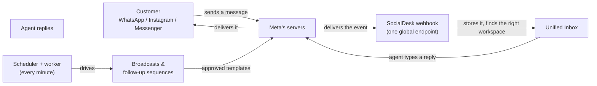
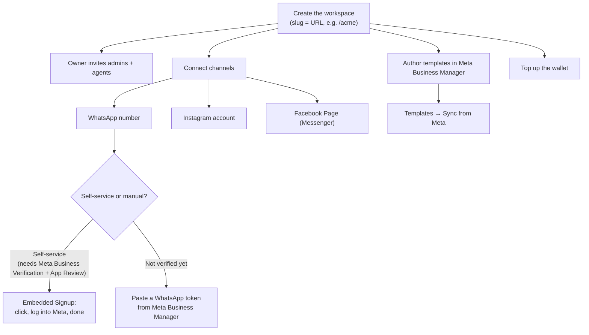
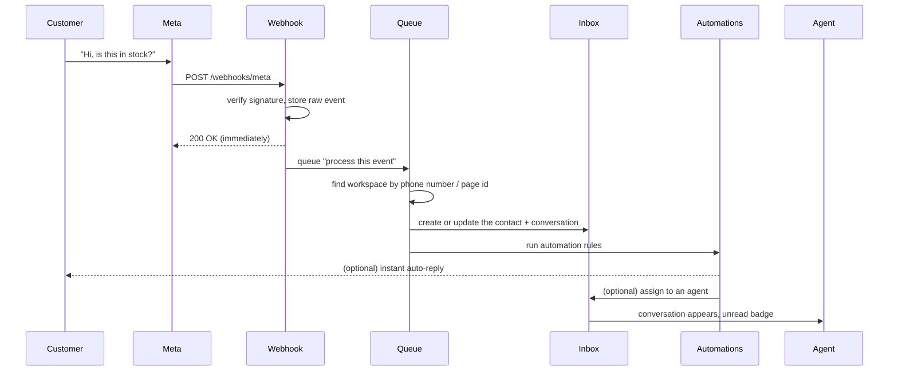
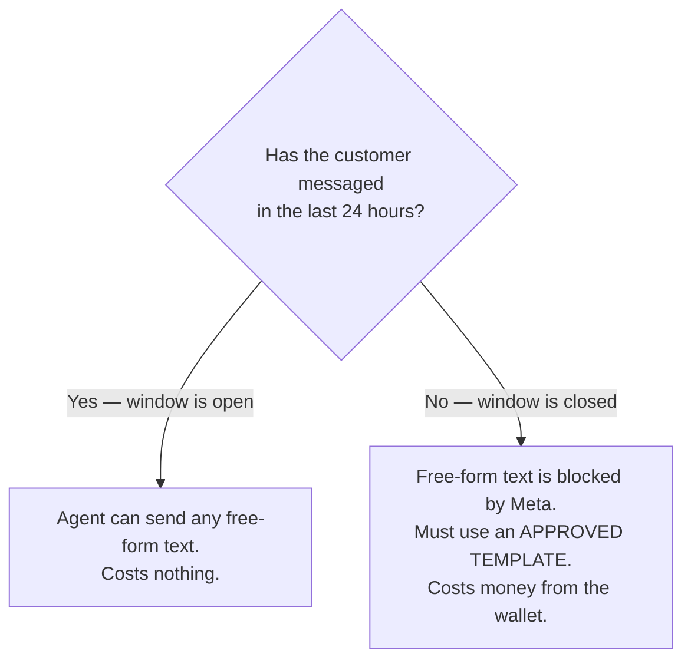
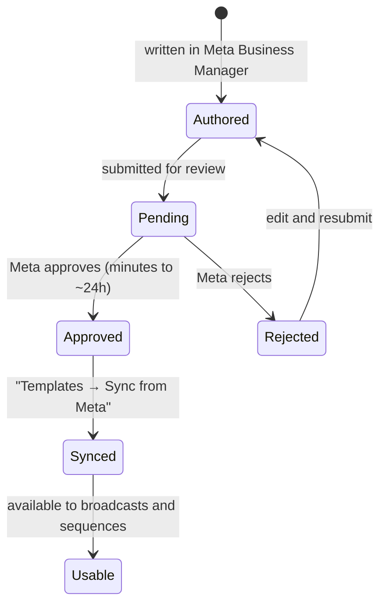
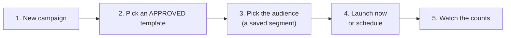
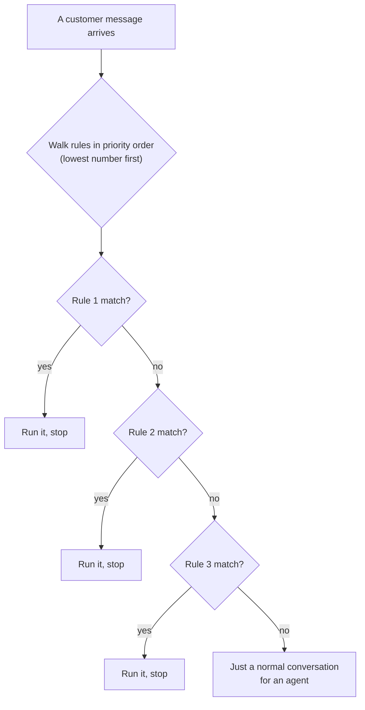
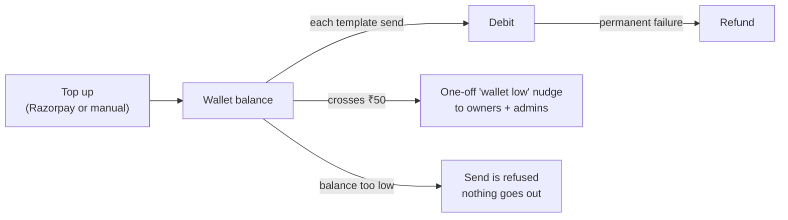

# SocialDesk — How It Works

A plain-language walkthrough of the whole system, written so you can hand it to a client
(or read it aloud on a call). Every number here is the value actually configured in the app.

> **The 60-second version.** SocialDesk is one shared inbox where your team answers
> WhatsApp, Instagram and Messenger from a single screen. Customer messages arrive by
> themselves; your replies go out from the same screen. Because Meta only lets a business
> send free-form text **within 24 hours** of the customer's last message, anything outside
> that window has to be an **approved template** — that's the constraint that shapes
> broadcast campaigns, follow-up sequences, and the prepaid wallet that pays for each
> template send.

---

## Contents

1. [Who's who](#1-whos-who)
2. [The big picture](#2-the-big-picture)
3. [Day 1 — getting connected](#3-day-1--getting-connected)
4. [Inbound — a customer messages you](#4-inbound--a-customer-messages-you)
5. [Outbound — the 24-hour rule](#5-outbound--the-24-hour-rule)
6. [Templates — the approval lifecycle](#6-templates--the-approval-lifecycle)
7. [Broadcast campaigns](#7-broadcast-campaigns)
8. [Audiences (segments)](#8-audiences-segments)
9. [Automations](#9-automations)
10. [CRM and pipeline](#10-crm-and-pipeline)
11. [Wallet and billing](#11-wallet-and-billing)
12. [Team and permissions](#12-team-and-permissions)
13. [Analytics and notifications](#13-analytics-and-notifications)
14. [What has to keep running](#14-what-has-to-keep-running)
15. [Current limits — say these out loud](#15-current-limits--say-these-out-loud)
16. [Client FAQ](#16-client-faq)
17. [Glossary](#17-glossary)

---

## 1. Who's who

| Actor | What they are | What they can do |
| --- | --- | --- |
| **Workspace** | The client's account. Everything is scoped to it. | Each workspace has its own channels, contacts, wallet, team. One workspace can never see another's data. |
| **Owner** | The customer's main account. | Everything. Can never be demoted or removed. |
| **Admin** | A manager. | Everything an agent can, plus invite/manage agents, billing, wallet top-ups. |
| **Agent** | A support person. | Answer conversations, manage contacts. **Cannot** open Team or billing. |
| **Platform console** | SocialDesk's own staff view (us, not the client). | Suspend/activate a workspace, extend trials, credit a wallet, edit plans, inspect webhook logs. |

The client will realistically only ever use **Owner / Admin / Agent**.

---

## 2. The big picture



Two things worth emphasising to a client:

1. **Messages arrive on their own.** Nobody has to forward anything, export a CSV, or refresh.
2. **Replies are sent from the inbox.** The agent types once; SocialDesk handles the Meta plumbing.

---

## 3. Day 1 — getting connected



### 3.1 Channels

| Channel | How it connects | Notes |
| --- | --- | --- |
| **WhatsApp** | Self-service "Embedded Signup" **or** paste a token | Self-service goes live only after the client completes **Meta Business Verification + App Review**. Until then, the manual token route works fine — it's just a few more clicks in Meta. |
| **Instagram** | Meta login | Capped by plan (e.g. 5 accounts). |
| **Messenger** | Meta login, via the client's Facebook Page | Managed alongside the same Page. |

### 3.2 Plan and trial

- New workspaces start on a **14-day free trial** of the **Growth** plan.
- Plan limits are **monthly active contacts**, **agent seats** and **Instagram accounts**.
- **Over-quota contacts are billed, not blocked.** This is deliberate: an inbound lead is
  never dropped because a quota was hit. Extra usage is charged per block (e.g. every 500
  contacts beyond the plan).

### 3.3 Team

- Invites go out by email as a link that expires in **7 days**.
- Seats are counted as **members + pending invites**, so an unused invite still holds a seat.

---

## 4. Inbound — a customer messages you



Step by step, in language you can use:

1. **Meta receives the message** and forwards it to SocialDesk.
2. **SocialDesk verifies it really came from Meta** (cryptographic signature check), stores the
   raw payload as an audit trail, and acknowledges Meta **immediately**. Meta requires a fast
   acknowledgement or it retries, so the heavy work is deliberately queued.
3. **The right workspace is found** from which business number or Page the message came in on.
   This is why one webhook can serve every client safely — the routing is by the channel's own ID.
4. **The contact is created or updated**, and the conversation is opened (or reused).
5. **Automations run**: an auto-reply may answer instantly, and a routing rule may assign the
   thread to a specific person.
6. **An agent sees it** in the Unified Inbox with an unread badge.

> Because step 2 is queued, an inbound message can take up to about **a minute** to appear in
> the inbox. See [§15](#15-current-limits--say-these-out-loud).

---

## 5. Outbound — the 24-hour rule

This is **the single most important rule** to explain, because it comes from Meta, not from us.



| Situation | What can be sent | Cost |
| --- | --- | --- |
| Customer messaged in the **last 24 hours** | Anything — free-form text, images, notes | **Free** |
| **More than 24 hours** since their last message | Only a **Meta-approved template** | Charged per send |
| Customer **opted out** | Nothing marketing-related | — |

Every customer message **re-opens** the 24-hour window. That is the whole game: keep the
conversation warm and replies stay free; reach out cold and each message costs money.

If an agent tries to type free-form text after the window has closed, the app explains it and
points them at a template instead of failing silently:

> *"The 24-hour reply window has closed. Send an approved template message instead."*

---

## 6. Templates — the approval lifecycle

Templates are **authored and approved inside the client's own Meta Business Manager**. SocialDesk
mirrors them — it never invents templates, so what you see is always what Meta has approved.



- Until a template shows **approved**, it **cannot** be used in a broadcast or a follow-up
  sequence. The campaign screen shows a clear **"template pending approval"** state rather
  than letting a send fail.
- When Meta approves or rejects a template, the workspace gets a **notification** and the
  status updates on the next sync.
- A template with variables (e.g. *"Hi {{1}}, your order {{2}} has shipped"*) requires the
  right number of values — the app validates this before sending.

**Suggested talk track:** *"You write the message once in Meta, Meta approves it, and from then
on it's a reusable, legally-compliant block you can broadcast or schedule. Meta does not allow
us to improvise marketing text to cold contacts — and the app enforces that for you."*

---

## 7. Broadcast campaigns

A campaign is: **one approved template + one audience + a launch time.**



### How it actually sends

Campaigns ride a **per-minute heartbeat** that does a bounded slice of work each tick, so a
large broadcast can never flood the system or bill the wallet all at once:

| Setting | Value | Meaning |
| --- | --- | --- |
| Enrol batch | 500 / minute | Newly matching opted-in contacts added to the campaign |
| Send batch | 50 / minute | Messages queued per tick |
| Retry hold | 15 minutes | Parks an enrolment so a slow worker can't double-send |

Each individual send, in order:

1. Confirm the contact is **opted in** (opted-out contacts are skipped, always).
2. Charge the **wallet** for the template.
3. Send via Meta.
4. Track **sent → delivered → read**, or **failed**.
5. On a **permanent** failure, **refund** the wallet.

When the campaign finishes, the owner and admins get a **"campaign completed"** notification,
and the campaign row shows the totals: enrolled, sent, delivered, read, failed.

**Suggested talk track:** *"You pick a template and an audience, press launch, and watch it drain.
It goes out in controlled batches, only to people who opted in, and if a message fails
permanently you get the money back."*

---

## 8. Audiences (segments)

An audience is a saved rule that decides *who* a campaign targets. Filters combine with **AND**,
and opted-out contacts are excluded automatically — always.

| Filter | Example |
| --- | --- |
| **Tag** | Tagged "diwali-2026" |
| **Pipeline stage** | Currently in "Hot Lead" |
| **Source channel** | First came in via Instagram |
| **City** | Mumbai |
| **Last interaction** | Hasn't messaged in 30 days |

The screen shows a **live preview count** so the client can see exactly how many people they're
about to message (and roughly what it will cost) *before* launching.

**Suggested talk track:** *"This is your 'who'. Build it once — 'everyone in Mumbai who's a hot
lead and hasn't messaged in 30 days' — save it, and reuse it for any campaign."*

---

## 9. Automations

Three kinds of automation live in one screen. They are evaluated **in priority order, first match
wins**.



### 9.1 Auto-reply

Answers an inbound message automatically. Triggers: **keywords**, **first message from a new
contact**, or **outside business hours**.

- Sent as a **bot** message. It does **not** count as the agent's first response, does not mark
  the thread unread, and does not assign it. In the inbox it's labelled **"Automation"**, so
  nobody is confused about whether a human replied.
- Free-form text, because it's always inside the 24-hour window.
- **Cooldown: 60 minutes per contact.** This stops one broad rule (say, one with no keywords)
  turning a chatty customer into a reply storm.

### 9.2 Routing

Claims the thread for an agent:

| Mode | Meaning |
| --- | --- |
| **Round robin** | The agent with the **fewest conversations** |
| **Least busy** | The agent with the **fewest open** conversations |
| **Specific user** | Always the same person |

The conversation being routed is excluded from the count (so it can't skew its own decision),
and if nobody is available it falls back to the shared round-robin assigner rather than becoming
unassigned.

### 9.3 Follow-up sequence

Timed nudges for a thread that has gone quiet — each step is a **template**, because by then the
24-hour window has certainly closed.

```
Step 1:  +1 day   "Still interested?"      (approved template)
Step 2:  +3 days  "Here's 10% off"         (approved template)
Step 3:  +7 days  "Last chance"            (approved template)
```

Business hours are configurable (default **Mon–Sat, 10:00–19:00 IST**).

A sequence run **cancels itself** the moment any of these happens:

- the customer replies (the conversation is live again — no robot needed),
- the customer opts out,
- the template stops being approved,
- the channel is disconnected,
- the wallet doesn't have enough balance.

**Suggested talk track:** *"It's a 'first match wins' rule engine: instant answers for the obvious
questions, automatic assignment so nothing sits unowned, and gentle follow-ups that stop the
second the customer replies."*

---

## 10. CRM and pipeline

Every conversation is attached to a contact with a lightweight CRM around it:

| Piece | What it does |
| --- | --- |
| **Contacts** | Unified record: name, phone, city, source channel, opt-in status |
| **Tags** | Free-form labels — power audiences |
| **Pipeline stages** | `New Inquiry → Pricing Inquiry → Qualified → Hot Lead → Won / Customer` |
| **Activity log** | What happened, when, and who did it |
| **Canned responses** | Saved replies agents insert with one click |
| **Internal notes** | Private staff notes that are never sent to the customer |

New workspaces get those five pipeline stages by default; they can be renamed.

---

## 11. Wallet and billing



| Item | Value |
| --- | --- |
| Top-up methods | **Razorpay** (self-service) or **manual** (a SocialDesk admin credits it) |
| WhatsApp **marketing** template | **88 paise** per send |
| WhatsApp **utility / authentication** template | **30 paise** per send |
| Free-form reply **inside** the 24-hour window | **Free** |
| Low-balance alert | One-off, when the balance crosses **₹50** |
| Subscription | Monthly plan + 18% GST, with a 14-day trial |

Key behaviours to communicate:

- **Prepaid, never surprising.** No balance means the send is *refused* — nothing is queued,
  nothing is half-charged.
- **Refunds are automatic** on permanent delivery failures.
- **Every movement is logged** as a wallet transaction with a reason, so billing questions are
  answerable line by line.
- The message rates are configured to match Meta's India rate card plus margin; they can be
  adjusted centrally without a redeploy.

---

## 12. Team and permissions

| | Owner | Admin | Agent |
| --- | --- | --- | --- |
| Answer conversations | ✅ | ✅ | ✅ |
| Manage contacts | ✅ | ✅ | ✅ |
| Invite / manage agents | ✅ | ✅ | ❌ |
| Billing + wallet | ✅ | ✅ | ❌ |
| Manage plans / delete workspace | ✅ | ❌ | ❌ |

Rules the client can rely on:

- The **owner can never be removed or demoted**.
- Nobody can remove themselves (no accidental lock-outs).
- **Seats = members + pending invites**, and the plan caps seats.
- Invite links expire in **7 days**.

---

## 13. Analytics and notifications

**Analytics** (nav item, right next to the Inbox) — selectable **7 / 30 / 90-day** windows
(default 30): conversation volumes, how quickly first responses happen, campaign performance,
and wallet usage.

**Notifications** — the bell in the header. Four things raise one:

| Notification | When |
| --- | --- |
| Campaign completed | A broadcast finishes |
| Wallet low | Balance crosses ₹50 |
| Template approved / rejected | Meta decides on a template |
| Member joined | An invite is accepted |

---

## 14. What has to keep running

Two background processes make the "automatic" parts automatic. Both run **once per minute**:

| Process | What it does if running | What breaks if it stops |
| --- | --- | --- |
| **Scheduler** | Enrols audiences, queues campaign sends, advances follow-up sequences | Scheduled broadcasts and follow-up sequences silently stop |
| **Queue worker** | Delivers outbound messages, processes inbound webhooks | Messages stop moving in *both* directions |

Worth knowing for the client call: these are the only moving parts that need the server to be
healthy. Everything else is on-demand.

---

## 15. Current limits — say these out loud

Better the client hears these from you now than discovers them later.

1. **Timing.** Inbound and outbound work is queued and the worker ticks **once a minute**, so a
   message can take up to about **60 seconds**. The inbox is not broken — it's batched. A
   one-line change (processing the webhook after the response is flushed) brings this down to
   **1–2 seconds**; it's ready to ship if the client wants it.
2. **Self-service WhatsApp connection** needs **Meta Business Verification + App Review** before
   it can be offered to real customers. Until that's approved, channels are connected by pasting
   a token from Meta Business Manager — same end result, more clicking.
3. **Template approval is Meta's call**, typically minutes to ~24 hours. Nothing in SocialDesk
   can speed it up.
4. **Instagram / Messenger** allow free-form replies only inside the 24-hour window; the
   `HUMAN_AGENT` tag (which extends that for human support) is not built yet.
5. **Invite emails** currently write to the server log rather than really sending (production
   mail left on the safe default). The invite **link is shown once** to the inviter to pass on —
   by WhatsApp, typically.
6. **Message rates are indicative.** They currently mirror Meta's India rate card plus margin;
   confirm the final commercial rates before quoting them to a client.

---

## 16. Client FAQ

**"What exactly does each message cost us?"**
Free-form replies inside the 24-hour window: nothing. A marketing template: 88 paise. Utility or
authentication templates: 30 paise. That's per send, and it comes out of the prepaid wallet.

**"Can we message customers whenever we like?"**
Only inside the 24-hour window, or with an approved template. That's Meta's rule for every
business on WhatsApp, not a SocialDesk limit.

**"What if we run out of credit mid-broadcast?"**
Sends are refused rather than queued, so you never half-deliver. You top up and the campaign
resumes; failed sends are refunded.

**"How fast do messages show up?"**
Right now up to ~60 seconds (batched, once a minute). It can be dropped to 1–2 seconds — ask.

**"Who on our side can see the billing?"**
Owners and admins. Agents never see billing or the Team screen.

**"What happens if Meta rejects a template?"**
You're notified, the template is marked rejected, it can't be used in a broadcast, and you edit
and resubmit it in Meta Business Manager.

**"Can two of us reply to the same customer by accident?"**
Assignment and routing rules make an owner explicit, and the whole team sees the same thread in
one inbox with unread state.

**"Is our data separate from your other clients?"**
Yes. Every query is scoped to the workspace, and the platform console (SocialDesk staff only) is
the single deliberate exception, used for support.

---

## 17. Glossary

| Term | Plain meaning |
| --- | --- |
| **Workspace** | The client's account |
| **Channel** | A connected WhatsApp number, Instagram account or Facebook Page |
| **24-hour window** | Meta's rule: free-form replies only within 24h of the customer's last message |
| **Template** | A pre-approved message you can send outside that window (and that costs money) |
| **Broadcast / Campaign** | One template sent to one audience |
| **Segment / Audience** | A saved filter defining who a campaign targets |
| **Automation** | A rule that replies, assigns, or follows up on its own |
| **Wallet** | Prepaid credit that pays for template sends |
| **MAC** | Monthly Active Contacts — the main usage number plans are priced on |
| **Opt-in / opt-out** | The customer's consent flag; opted-out contacts are never messaged |
| **Webhook** | The endpoint Meta calls when a customer messages you |
